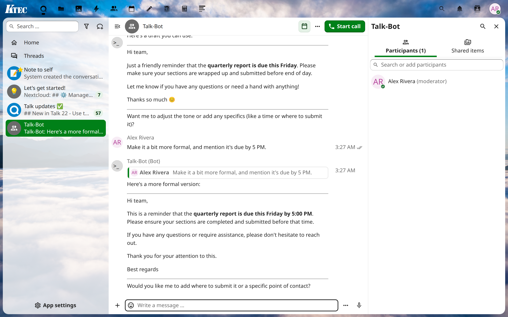
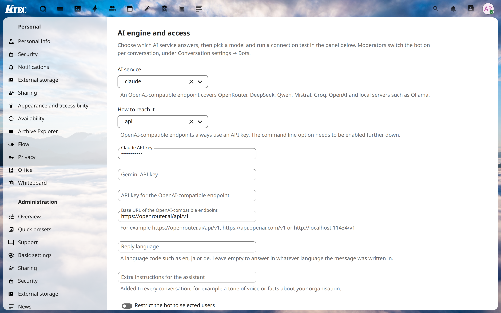

# Talk-Bot

**Chat with an AI assistant right inside Nextcloud Talk, powered by AI-Hub.**
**Nextcloud Talk の中で、AI アシスタントとチャットできます。返答には AI-Hub を使います。**

> One small PHP app. No external daemon, no webhook endpoint, no Docker, no separate machine. The AI service, key and model live in **AI-Hub**, the shared gateway the whole Base series uses.
> 小さな PHP アプリが 1 つだけです。外部のデーモンも、Webhook のエンドポイントも、Docker も、別のマシンも必要ありません。AI サービス、API キー、モデルの設定は、Base シリーズ共通のゲートウェイである **AI-Hub** で行います。

[English ↓](#english) · [日本語 ↓](#japanese)

---

## Screenshots

| | |
|---|---|
|  |  |
| Answering in a Talk conversation Talk の会話でボットが返答している画面 | Talk-Bot's own settings Talk-Bot の設定画面 |

---

## English

Talk-Bot turns any Nextcloud Talk conversation into an AI chat. It runs as a Talk
in-app bot, entirely inside Nextcloud — a few hundred kilobytes of PHP, installed
from the App Store like any other app. There is no separate service to install and
keep running, and it answers off the request path, so posting a message never
waits for the model.

### Requires AI-Hub

Talk-Bot no longer connects to a model itself. The AI service, key, model and
limits live in **AI-Hub** — a separate app that is the one place AI is set up for
the whole Base series — and Talk-Bot asks it for every answer. Install AI-Hub from
the App Store, choose the AI service, key and model in its settings, and Talk-Bot
uses them. The same AI-Hub also serves the other apps, so there is only one place
to configure and one bill to watch. Until AI-Hub is installed and set up, the bot
replies with how to do it rather than answering.

### A plain, sandboxed assistant

Everyone talks to the same assistant: it answers questions and nothing more. It has
no tools of any kind — no files, no shell, no network, no way to touch the server.
An administrator who wants a chat assistant with shell access uses **NetBase's
assistant** instead; Talk-Bot does not do that.

### And the rest

- **Per-conversation memory.** Every user keeps their own history in every room. Optionally forget it a set number of days after the last message (default: kept until `?reset`).
- **Fair use.** Limit questions per user per minute and how many answers are worked on at once, per user and in total.
- **Commands** — `?help`, `?reset`, `?status`, `?model`, and more.
- **Access control.** Optionally restrict the bot to an allow-list of users.
- **Reply language.** Answer always in a fixed language, or mirror the user.

### Requirements

- Nextcloud 31 – 35 with the **Talk** app (Talk 21 or later: Nextcloud 30 / Talk 20 cannot run bots of this kind)
- The **AI-Hub** app, installed and set up with an AI service, key and model
- PHP 8.1 or newer

### Setup

1. Install and enable the app.
2. Install and enable **AI-Hub**, then open **Administration settings → AI-Hub**
   and choose the AI service, key and model.
3. In **Administration settings → Talk-Bot**, set the reply language, any extra
   instructions and who may use the bot (all optional).
4. In any conversation, a moderator opens **Conversation settings → Bots** and
   switches **Talk-Bot** on.
5. Write a message. The bot reacts with 💭 while it thinks and then answers.

### How it answers without blocking the chat

Talk calls in-app bots while the sender's message is still being posted, so the
model is not called there. The bot hands the work to a second request addressed
to this server, stops waiting for it after two seconds, and that request asks
AI-Hub for the answer and posts it through Talk's bot API when the model is done.
If the server cannot reach itself over HTTP, the work falls back to a background
job instead, and the answer arrives with the next cron run.

### Privacy and security

- Messages sent to the bot go through AI-Hub to the AI provider configured there,
  and nowhere else. Point AI-Hub at a local model server and nothing leaves the
  machine.
- Talk-Bot holds no API key of its own; the key lives in AI-Hub, encrypted in the
  Nextcloud configuration and never sent back to the browser.
- The bot has no tools at all: it cannot read files, run commands or reach anything
  on your server.

### Commands

| Command | Effect |
|---|---|
| `?help` | Show the command list |
| `?reset` | Forget this conversation and start over |
| `?undo` | Remove the last exchange |
| `?retry` | Answer the last question again |
| `?summary` | Summarize the conversation so far |
| `?lang <code>` | Set the reply language for this conversation (`?lang off` to follow each user) |
| `?status` | Show the AI-Hub connection and how much is remembered |
| `?model` | Show the model AI-Hub answers with (set in AI-Hub) |
| `?update` | Where to manage the AI service and model (in AI-Hub) |
| `?whoami` | Show who you are |
| `?version` | Show the app version |
| `?roll`, `?flip`, `?8ball`, `?ping`, `?joke` | For fun |

---

## 日本語

Talk-Bot は、Nextcloud Talk のどの会話でも AI とチャットできるようにするアプリです。Talk のアプリ内ボットとして、Nextcloud の中だけで動作します。本体は数百KBの PHP で、ほかのアプリと同じように App Store からインストールできます。別にインストールして動かし続けるサービスはありません。また、返答はメッセージの投稿処理とは別に作成するため、メッセージを送るときに AI モデルの返答を待たされることはありません。

### AI-Hub が必要です

Talk-Bot は、AI モデルに直接接続しなくなりました。AI サービス、API キー、モデル、利用制限は、Base シリーズ全体の AI の設定を 1 か所にまとめた別のアプリ **AI-Hub** で設定し、Talk-Bot は返答のたびに AI-Hub に問い合わせます。App Store から AI-Hub をインストールし、その設定画面で AI サービス、API キー、モデルを選べば、Talk-Bot はその設定を使って返答します。AI-Hub はほかのアプリでも共通で使うため、設定する場所も、利用料金を確認する先も 1 か所で済みます。AI-Hub をインストールして設定するまでは、ボットは質問に答える代わりに、その手順を返答します。

### サンドボックス化されたシンプルなアシスタント

全員が同じアシスタントと会話します。アシスタントは質問に答えるだけで、ツールは一切持っていません。ファイルにも、シェルにも、ネットワークにもアクセスできず、サーバーを操作する手段もありません。シェルを使えるチャットアシスタントが必要な管理者は、**NetBase のアシスタント** をお使いください。Talk-Bot にはその機能はありません。

### その他の機能

- **会話ごとの記憶** ― 各ユーザーの履歴は、ルームごとに個別に保持されます。最後のメッセージから指定した日数が過ぎたら、自動で消去することもできます（初期設定では `?reset` するまで残します）。
- **使いすぎの防止** ― ユーザーごとの 1 分あたりの質問数と、同時に作成する回答の数（ユーザーごと・全体）を制限できます。
- **コマンド** ― `?help`、`?reset`、`?status`、`?model` などが使えます。
- **利用できるユーザーの制限** ― 必要に応じて、ボットを使えるユーザーを許可リストで限定できます。
- **返答言語** ― 常に決まった言語で返答するか、ユーザーの言語に合わせるかを選べます。

### 動作要件

- Nextcloud 31〜35 と **Talk** アプリ（Talk 21 以降。Nextcloud 30 / Talk 20 では、この種類のボットは動作しません）
- **AI-Hub** アプリ（インストール済みで、AI サービス・API キー・モデルを設定してあること）
- PHP 8.1 以降

### 設定手順

1. アプリをインストールして有効にします。
2. **AI-Hub** をインストールして有効にし、**管理者設定 → AI-Hub** を開いて、AI サービス、API キー、モデルを選びます。
3. **管理者設定 → Talk-Bot** で、返答言語、アシスタントへの追加の指示、ボットを使えるユーザーを設定します（いずれも任意）。
4. ボットを使いたい会話で、モデレーターが **会話の設定 → ボット** を開き、**Talk-Bot** をオンにします。
5. メッセージを送ると、ボットが考えている間は 💭 のリアクションが付き、その後に返答が届きます。

### チャットを止めずに返答する仕組み

Talk は、送信者のメッセージを投稿する処理の途中でアプリ内ボットを呼び出します。そのため、この時点では AI モデルを呼び出しません。ボットは、このサーバー自身に宛てた 2 つ目のリクエストに処理を任せ、2 秒たつとその完了を待たずに戻ります。2 つ目のリクエストが AI-Hub に回答を求め、モデルの回答ができた時点で、Talk のボット API を通じて投稿します。サーバーが HTTP で自分自身に接続できない場合は、代わりにバックグラウンドジョブで処理し、次回の cron の実行時に返答が届きます。

### プライバシーとセキュリティ

- ボットに送ったメッセージは、AI-Hub を経由して、AI-Hub で設定した AI プロバイダーにだけ送られます。それ以外の送信先はありません。AI-Hub でローカルのモデルサーバーを指定すれば、データがマシンの外に出ることはありません。
- Talk-Bot は API キーを持ちません。キーは AI-Hub が管理し、Nextcloud の設定に暗号化して保存されます。ブラウザーに送り返されることはありません。
- ボットはツールを一切持っていません。ファイルの読み取りやコマンドの実行はできず、サーバー上の何にもアクセスできません。

### コマンド

| コマンド | 動作 |
|---|---|
| `?help` | コマンドの一覧を表示します |
| `?reset` | この会話の記憶を消して、最初からやり直します |
| `?undo` | 直前のやり取りを削除します |
| `?retry` | 直前の質問にもう一度回答します |
| `?summary` | ここまでの会話を要約します |
| `?lang <コード>` | この会話の返答言語を設定します（`?lang off` で各ユーザーの言語に合わせます） |
| `?status` | AI-Hub との接続状態と、記憶している量を表示します |
| `?model` | AI-Hub が回答に使うモデルを表示します（設定は AI-Hub で行います） |
| `?update` | AI サービスとモデルを管理する場所（AI-Hub）を案内します |
| `?whoami` | 自分のユーザー情報を表示します |
| `?version` | アプリのバージョンを表示します |
| `?roll`・`?flip`・`?8ball`・`?ping`・`?joke` | お遊び用のコマンドです |

---

[AGPL-3.0-or-later](LICENSE) · © KTEC
